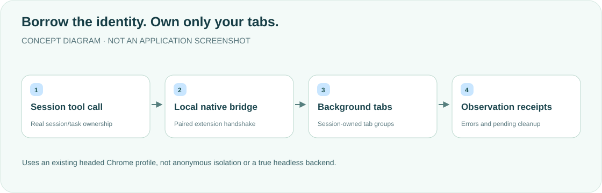

<div align="center">

<h1>chrome · Your browser, clear ownership</h1>
<p><strong>Keep Chrome's signed-in identity. Work in session-owned background tabs.</strong></p>
<p>A DeepSeek Harness desktop plugin and Chrome extension, without a new window or debug-port takeover.</p>
<p><a href="README.md">简体中文</a> · <strong>English</strong></p>
<p><a href="package.json">Plugin v0.2.3</a> · Extension v0.2.4 · <a href="LICENSE">MIT</a></p>
<p><a href="#features">Features</a> · <a href="#how-it-works">How it works</a> · <a href="#quick-start">Quick start</a> · <a href="#annotations-and-drafts">Annotations and drafts</a> · <a href="#boundaries-and-maintenance">Boundaries and maintenance</a> · <a href="#validation">Validation</a></p>
</div>

---

A reference for a personal desktop workflow, requiring compatible official DSH APIs and a paired extension. Unlike the old repository description mentioning a separate Chrome/CDP window, the current source uses **the existing Chrome profile through extension messaging**.

## Features

<table><tr>
<td width="33%"><strong>🌐 Existing identity</strong><br/><br/>Read and interact with HTTP(S) pages using the current Chrome profile's login state.</td>
<td width="33%"><strong>🗂 Session groups</strong><br/><br/>Each conversation owns a collapsed DSH tab group, without listing or controlling the user's other tabs.</td>
<td width="33%"><strong>🔎 Multiple observations</strong><br/><br/>Snapshots, text, accessibility trees, element references, screenshots and accessible frames/shadow roots.</td>
</tr><tr>
<td><strong>🖊 Confirmed annotations</strong><br/><br/>Select elements, edit requests on an extension confirmation page and explicitly place them in a DSH draft.</td>
<td><strong>📸 Files and media</strong><br/><br/>Screenshots, GIFs, uploads and saved batches follow the session's file policy and never overwrite existing outputs.</td>
<td><strong>🧭 Real receipts</strong><br/><br/>Handshake reports loaded versions, engine and ownership; failures, pending cleanup and missing capabilities stay visible.</td>
</tr></table>

## How it works



This is a **headed / borrowed-connection backend**, **not headless**. Routine background actions do not bring Chrome forward or create windows. Missing normal windows return `CHROME_NORMAL_WINDOW_REQUIRED`. Automated DOM/screenshot regression and anonymous isolation require a separately owned Chromium headless shell.

## Quick start

Requires compatible DSH desktop, a normal macOS Chrome window and pnpm 11.

```sh
export DSH_HOME="${DSH_HOME:-$HOME/.dsh}"
git clone https://github.com/yueyexiayu/dsh-chrome.git "$DSH_HOME/plugins/chrome"
cd "$DSH_HOME/plugins/chrome"
pnpm install --frozen-lockfile
```

Dependencies include a pinned JPEG decoder and official-contract local artifacts in `vendor/browser-execution/`, with no native compilation. Merge into `$DSH_HOME/profiles/desktop/cordis.patch.yml`:

```yaml
- insert:
    - id: chrome
      name: ../../plugins/chrome/lib/index.js
```

1. **Quit DSH fully with ⌘Q and reopen it** so the Host registers native messaging.
2. In the current profile, open `chrome://extensions`, enable developer mode and load `$DSH_HOME/plugins/chrome/extension` unpacked.
3. Chrome's debugger notice is expected, not a foreground switch. Use `chrome_browsers` to verify the actual handshake.
4. Reload the extension after extension changes; fully restart DSH after Host/Client changes and verify loaded versions in a new session.

Plugin source 0.2.3 requires extension 0.2.4. Older workers return `CHROME_EXTENSION_VERSION_MISMATCH`, not fallback or unavailable. Policy artifact `0.2.1-alpha.4.browser-policy.1` is not a family-wide DSH release. Source declarations are not runtime proof.

## Annotations and drafts

Click the DSH Chrome toolbar icon and select up to 12 HTTP(S) elements. “Edit requests” checks the original tab/URL and captures a screenshot before opening an independent extension confirmation page—**this step changes the active tab**. Choose Change/Question, enter each Request and explicitly confirm placement in the DSH draft. Page text, HTML and styles remain data.

Annotations never send the conversation automatically. Success requires Host-confirmed persistence, with real JPEG decoding and size/memory checks. Delivery leases prevent duplicate insertion by multiple windows. Deletion waits for text/image insertion and draft persistence. Interrupted uncertain delivery offers explicit recovery or receipt confirmation instead of blind resending. Official drafts persist text/references but not image attachments, so restart recovery may need to restore an image. Confirmed annotations keep no screenshot copy.

## Boundaries and maintenance

<details>
<summary><strong>Sessions, files, observations and capability limits</strong></summary>

- HTTP(S) only. Pages are untrusted data, not instructions. Refs come from the latest snapshot/query/find/a11y and are renumbered. Frame access depends on actual Chrome contexts; not every nested/OOPIF page is guaranteed.
- Same-owner work is serialized; owners share a single-flight connection. `chrome_close` closes only this group, not Chrome. `chrome_resize` reads dimensions. Dialogs require explicit handling.
- Password values are omitted from default observations. Active JavaScript is outside redacted observation interfaces: do not use it to read credentials. Cookie/storage values are hidden by default; secret-shaped entries stay redacted.
- `chrome_downloads` explicitly returns `UNSUPPORTED_BROWSER_CAPABILITY`: DownloadItem cannot prove tab ownership, so global download history is not read. Normal downloads work; independent download directories/browser contexts are unsupported.
- Profile cookies/storage share identity, not anonymous or cross-task context isolation. Offline network/JavaScript restrictions and independent downloads belong in an owned backend, not borrowed tabs.
- Outputs follow official session file policy and create new files only. Read-only mode forbids saving; missing services never fall back to unrestricted writes. Screenshots use formal image attachments when supported by the model.
- Shortcuts use `$DSH_HOME/cache/chrome-shortcuts.json`. Only ENOENT means no store; corruption and locking failures remain errors. Private atomic writes and cancellable 5-second lock waits do not delete another writer's lock. Inspect abandoned locks/temp files only after confirming no active saves; never delete the whole cache.

</details>

<details>
<summary><strong>Cleanup receipts, bridge conflicts and legacy migration</strong></summary>

`openCaptureSession` creates a dedicated owner/target. Closing freezes new work, interrupts owned in-flight operations and awaits actual Chrome Promise/create settlement. Unconfirmed cleanup retains the owner as `CHROME_CLEANUP_PENDING`; explicit close can retry. Timeout, disconnection or a new worker's empty ledger is not proof of cleanup. Create settlement and close ACK each wait up to 3 seconds. Unknown worker generation remains a typed retained unknown. This is not a durable cross-Host-crash transaction; hard-worker-crash acceptance remains separate.

A DSH_HOME supports one Chrome profile and one controlling connection at a time. Conflicts do not evict an active controller. Disable the extension in other profiles before reloading the intended one. Random sockets are cleaned only by their owner. Legacy `$DSH_HOME/cache/dsh-chrome.sock` cannot be probed safely and is not deleted automatically. For that legacy migration only, fully exit Chrome/DSH, confirm the old native host exited, then remove only the fixed old endpoint—not cache or random sockets.

The production gate checks OS peer PID/real executable path and accepts only valid `/Applications/DeepSeek Harness[ <SemVer>].app/Contents/MacOS/DeepSeek Harness` paths, rejecting Node, Helpers, fake paths and symlinks. This is path trust, not code-signature authentication. See [native bridge verification](docs/native-bridge-verification.md), the [execution helper](lib/execution.js) and [capture adapter](lib/browser.js). Contracts cover managed entry points, not arbitrary external scripts or OS handoff.

</details>

## Validation

```sh
cd "$DSH_HOME/plugins/chrome"
pnpm install --frozen-lockfile
node test/run-pure.mjs
```

Pure source/VM tests do not launch real Chrome or a Native Host. Full `node --test test/*.test.mjs` requires an independently verified installed App supporting RunAsNode (`ELECTRON_RUN_AS_NODE=1`), an explicitly selected actual path and authorized local process verification. Missing conditions fail; ordinary Node, fake argv0 and GUI fallbacks do not qualify. Fixtures use private temporary DSH_HOME/sockets, not actual registration or cache.

**This is a documentation update: bilingual content, diagrams, links and layout only. Product suites were not rerun, the extension was not reloaded and DSH was not restarted.** VM/protocol results cannot replace paired-extension end-to-end acceptance.

## License

[MIT License](LICENSE). Remove this plugin's load entry and disable the Chrome extension to uninstall, keeping other plugins and browser data intact.

<div align="center"><sub>Keep the identity. Know who owns every action. · <a href="README.md">阅读中文版 →</a></sub></div>
