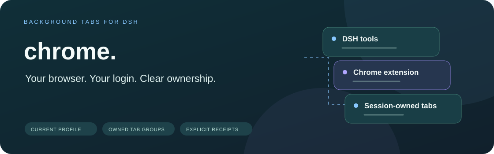
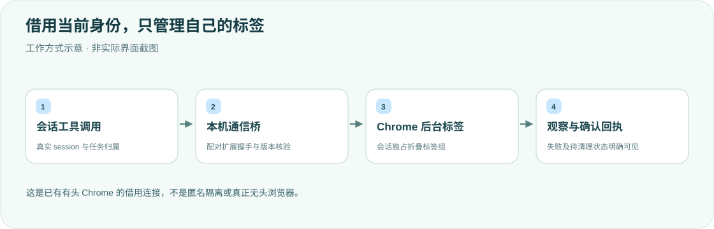

<div align="center">

<h1>chrome · 当前浏览器，清楚的归属</h1>
<p><strong>沿用 Chrome 登录态，在会话专属的后台标签组中工作。</strong></p>
<p>DeepSeek Harness 桌面插件＋Chrome 扩展，不另开窗口、不使用调试端口接管现有标签。</p>
<p><strong>简体中文</strong> · <a href="README.en.md">English</a></p>
<p><a href="package.json">插件 v0.2.5</a> · 扩展 v0.2.5 · <a href="LICENSE">MIT</a></p>
<p><a href="#核心能力">核心能力</a> · <a href="#工作方式">工作方式</a> · <a href="#快速开始">快速开始</a> · <a href="#标注与草稿">标注与草稿</a> · <a href="#边界与维护">边界与维护</a> · <a href="#验证">验证</a></p>
</div>

---

这是面向个人桌面工作流的参考实现，依赖兼容的 DSH 官方接口和配对扩展。源码与旧仓库简介中的“独立 Chrome/CDP 窗口”不同：当前实现使用**正在使用的 Chrome profile 和扩展通信**。

## 核心能力

<table><tr>
<td width="33%"><strong>🌐 当前登录身份</strong><br/><br/>复用现有 Chrome profile，在后台进行 http/https 页面读取与交互。</td>
<td width="33%"><strong>🗂 会话标签组</strong><br/><br/>每个对话独占折叠 DSH 标签组；不枚举或操作用户其他标签。</td>
<td width="33%"><strong>🔎 多种观察方式</strong><br/><br/>快照、文本、无障碍树、元素引用、截图，以及可访问 frame/shadow root。</td>
</tr><tr>
<td><strong>🖊 明确确认的标注</strong><br/><br/>页面选元素后在扩展侧栏填写要求，明确放入 DSH 草稿，不自动发送，也不离开当前网页。</td>
<td><strong>📸 文件与媒体</strong><br/><br/>截图、GIF、上传和快捷批处理遵从当前会话文件策略；不覆盖已有输出。</td>
<td><strong>🧭 实际连接回执</strong><br/><br/>真实握手报告运行版本、引擎与归属；失败、未完成清理和能力缺失直接可见。</td>
</tr></table>

## 工作方式



本后端是 **headed / borrowed-connection**，即借用已有有头浏览器，**不是无头浏览器**。普通后台操作不拉前台、不另建窗口；原生窗口不存在时返回 `CHROME_NORMAL_WINDOW_REQUIRED`。自动 DOM、截图回归或匿名隔离任务应另用自有 Chromium headless shell。

访问当前 DSH 本机 Web 地址时，插件在 Host 内完成浏览器授权，再打开目标页面；仅匹配当前本机监听地址，其他网站不受影响。

## 快速开始

需要兼容的 DSH 桌面端、macOS Chrome 普通窗口和 pnpm 11。

```sh
export DSH_HOME="${DSH_HOME:-$HOME/.dsh}"
git clone https://github.com/yueyexiayu/dsh-chrome.git "$DSH_HOME/plugins/chrome"
cd "$DSH_HOME/plugins/chrome"
pnpm install --frozen-lockfile
```

依赖包含锁定 JPEG 解码器及 `vendor/browser-execution/` 的官方契约本地构建；不执行原生编译。将下项合并到 `$DSH_HOME/profiles/desktop/cordis.patch.yml`：

```yaml
- insert:
    - id: chrome
      name: ../../plugins/chrome/lib/index.js
```

1. **⌘Q 完全退出 DSH 后重开**，由 Host 注册本机通信主机。
2. 在当前 Chrome profile 打开 `chrome://extensions`，启用开发者模式，加载 `$DSH_HOME/plugins/chrome/extension`。
3. 保留扩展的调试提示；这是 Chrome 固定提示，不代表插件拉前台。调用 `chrome_browsers` 核对真实握手。
4. 扩展文件更新后点扩展卡片的「重新加载」；Host/Client 更新后完整重启 DSH，并在新会话确认实际版本。

源码插件0.2.5必须配扩展0.2.5；旧扩展返回 `CHROME_EXTENSION_VERSION_MISMATCH`，不降级或伪装 unavailable。共享 policy artifact 为 `0.2.1-alpha.4.browser-policy.1`，不是 DSH 全家族发布；源码声明不等于运行版本。

## 标注与草稿

点工具栏 DSH Chrome 图标，在 http/https 页面最多选12项。页面浮层只点选，不接收要求。点击「编辑要求」后检查原标签/URL和截图，在同一浏览上下文打开扩展源侧栏——**原 http(s) 标签不会切到整页审核页**。为每个元素选择操作类型并填写要求，再明确点击「放入 DSH 草稿」。页面文字、HTML和样式始终只是数据。

标注不自动提交对话；只有主机确认保存才报成功。截图需实际 JPEG 解码且有大小/内存限制；交付租约避免多窗口重复插入。文字和图片插入、草稿持久化确认后才删除标注。处理中断无法确认时不盲目重发，而是提示「重新放入草稿」或「已接收，完成确认」。官方草稿只持久化文字和引用，重启可能需要补图；成功确认后的标注不保留截图副本。

## 边界与维护

<details>
<summary><strong>会话、文件、观察与能力边界</strong></summary>

- 只接受 http/https。页面是不可信数据，不是新指令。refs 来自最新 snapshot/query/find/a11y，后续读取会重新编号；frame 访问以 Chrome 实际暴露的上下文为限，不保证全部嵌套/OOPIF。
- 同一 owner 串行，不同 owner 可共享 single-flight 连接；`chrome_close` 只关闭本对话组，不退出 Chrome。`chrome_resize` 只读尺寸。原生 alert/confirm/prompt 必须显式处理。
- 密码值不进入默认观察输出；主动 JavaScript 不属于脱敏接口，不用它读凭据。cookie/storage 默认不返回值，疑似秘密项始终打码。
- `chrome_downloads` 明确 `UNSUPPORTED_BROWSER_CAPABILITY`：Chrome DownloadItem 不能证明标签归属，插件不读取全局下载历史。普通下载仍工作；独立下载目录/browser context 不支持。
- 当前 profile 的 Cookie/storage 是共享身份，不是匿名或跨任务 context 隔离。离线断网、禁 JS 和独立下载要求必须由自有后端完成，不能污染借用标签。
- 输出遵从当前会话官方文件策略，只建新文件；只读模式禁止落盘，服务缺失不退回裸写入。截图在模型支持图片时通过正式附件返回。
- 快捷存储在 `$DSH_HOME/cache/chrome-shortcuts.json`。只有 ENOENT 表示尚无存储，损坏或锁失败明确报错；私有原子写入及5秒可取消锁等待不自动删除别人锁。异常留下的锁/临时文件需确认无保存任务后定点处理，不删除整个 cache。

</details>

<details>
<summary><strong>清理回执、桥接冲突与旧端点迁移</strong></summary>

`openCaptureSession` 为 capture 建专属 owner/target。关闭先冻结新操作，再中止所属标签的在途调用并等待实际 Chrome Promise/create 结算；不确认的清理以 `CHROME_CLEANUP_PENDING` 保留 owner，显式 close 可重试，不能把超时、断链或新 worker 空 ledger 当已清理。创建结算与 close ACK 各有3秒等待上限；未知 worker generation 仍保留 typed unknown。这不是跨 Host 崩溃的持久事务，hard worker crash 尚需独立验收。

同一 DSH_HOME 同时支持一个 Chrome profile 和一个控制连接；冲突不踢掉现有控制器。请先在其他 profile 禁用扩展，再在目标 profile 重载。随机 socket 只由自己清理；旧固定 `$DSH_HOME/cache/dsh-chrome.sock` 不安全探活且不会自动删除。迁移该旧端点时，先完整退出 Chrome/DSH并确认旧主机退出，再仅删除该旧端点，不删 cache 或随机端点。

生产 gate 用 OS peer PID/真实可执行路径，只允许合法 `/Applications/DeepSeek Harness[ <SemVer>].app/Contents/MacOS/DeepSeek Harness`，拒绝 Node、Helper、伪路径与 symlink；这是路径信任，不是代码签名认证。详见[原生桥接验收记录](docs/native-bridge-verification.md)、[执行契约](lib/execution.js)及[capture adapter](lib/browser.js)。契约只覆盖受管理入口，不限制任意外部脚本或 OS handoff。

</details>

## 验证

```sh
cd "$DSH_HOME/plugins/chrome"
pnpm install --frozen-lockfile
node test/run-pure.mjs
```

纯源码/VM套件不启动真实 Chrome或 Native Host。完整 `node --test test/*.test.mjs` 需要已核对支持 RunAsNode 的真实安装 App（设置 `ELECTRON_RUN_AS_NODE=1`），先明确实际安装路径和本机进程验收范围；条件不足明确失败，不用普通 Node、伪造 argv0或GUI启动兜底。fixtures 使用私有临时 DSH_HOME/socket，不写真实注册和 cache。

源码 `node test/run-pure.mjs` 已覆盖侧栏审核路径；源码声明不等于已加载版本。改 `extension/` 后须在目标 Chrome 重载扩展，改 Host 后须 ⌘Q。VM/协议通过也不能替代配对扩展的真机标注验收。

## 许可

[MIT License](LICENSE)。卸载移除本插件加载项并在 Chrome 禁用扩展，保留其他插件与浏览器数据。

<div align="center"><sub>保留登录身份，明确每一次操作的归属。 · <a href="README.en.md">Read in English →</a></sub></div>
